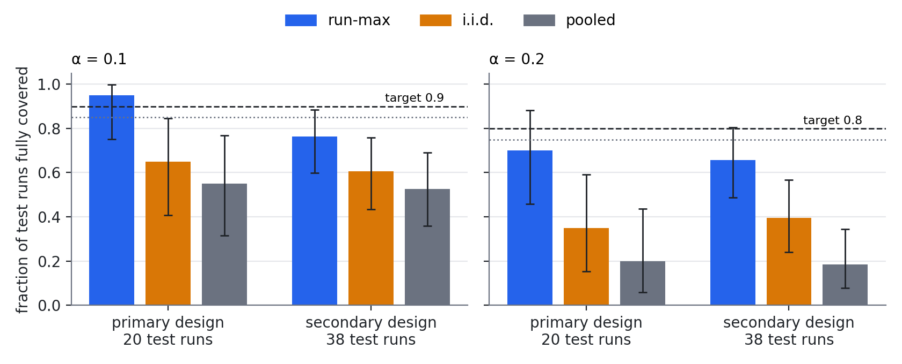
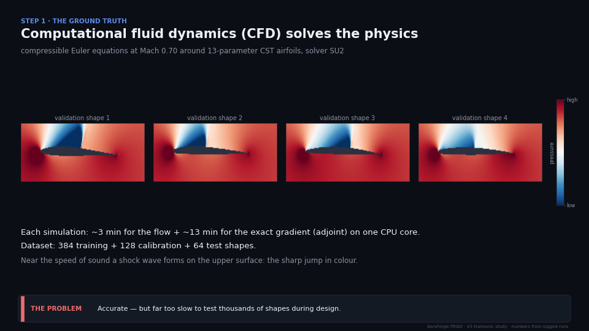
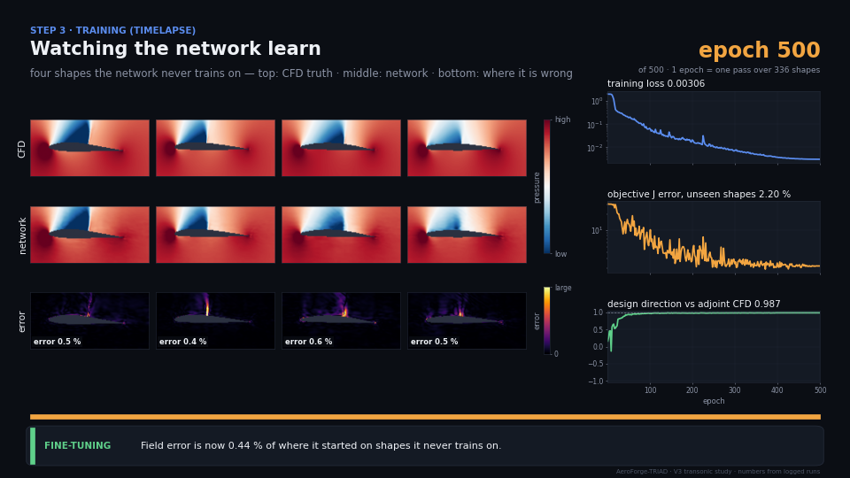
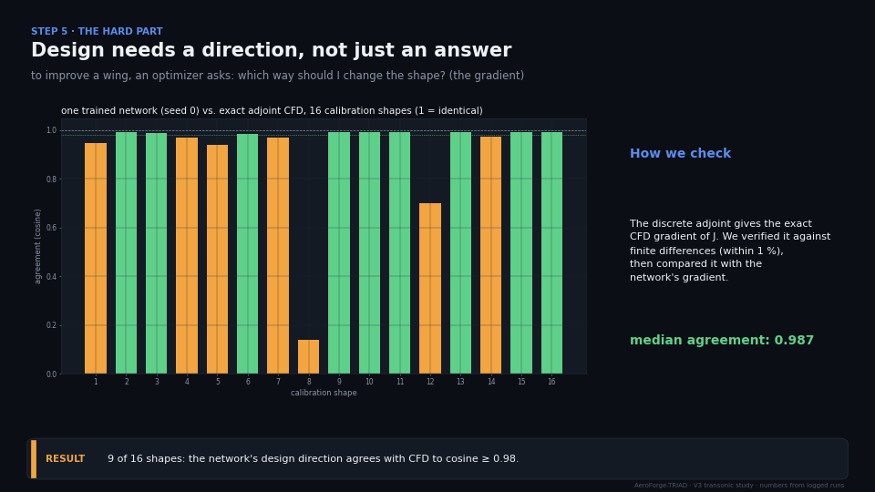
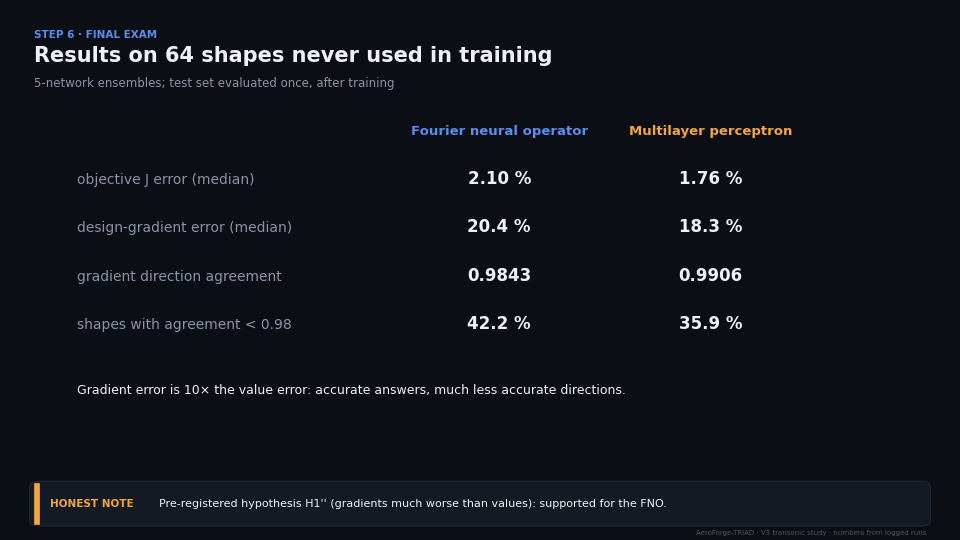

# AeroForge-TRIAD

**Can we trust surrogate gradients along an optimiser's path? Run-level conformal certificates for aerodynamic design**

Vishal Krishna Kumar, City University of Seattle

Neural surrogates such as Fourier neural operators (FNOs) are used to optimise shapes by following their gradients. Their accuracy, though, is usually reported for *values*, and their *gradients* are trusted along optimiser trajectories that leave the training data by construction. This repository contains a pre-registered CFD study of whether a distribution-free certificate on surrogate gradient error can hold for an **entire optimisation run**.

Paper (preprint, under review): [`paper/AeroForge-TRIAD_preprint.pdf`](paper/AeroForge-TRIAD_preprint.pdf)

## Main results

All numbers are from the paper.

- **The setup.** 13-dimensional CST airfoil design, with ground truth from SU2 CFD and discrete-adjoint gradients. Two flow regimes: laminar flow at Re = 1000, and transonic inviscid flow at M = 0.70 with shocks.
- **Standard (i.i.d.) conformal calibration fails along trajectories.** It covered 20 to 65% of test runs at alpha = 0.1, in every analysis.
- **The run-level certificate** calibrates on the maximum normalised gradient error over each calibration run.
  - It covered **20 of 20** laminar test runs at alpha = 0.1, where i.i.d. calibration covered 4 of 20.
  - It covered 19 of 20 in the first transonic design.
  - It **missed its pre-registered target** in a larger transonic design: 76% and 66% of 38 test runs at alpha = 0.1 and 0.2.
- **Such misses are expected with tens of calibration runs.** For exchangeable runs, the covered fraction of one calibration split is Beta-Binomial. So even an exactly valid certificate fails the pass rule in 17 to 27% of splits at these sample sizes.
- **A training-conditional (PAC) variant** restores coverage with 39 calibration runs (92% at alpha = 0.1), but certifies only a quarter of optimiser steps.
- **Common alternatives do not give a usable whole-run guarantee:**
  - uncalibrated Gaussian ensemble intervals cover 3 to 10% of runs
  - weighted conformal prediction and adaptive conformal inference cover 20 to 60%
  - a valid per-step Bonferroni certificate needs at least 119 calibration runs at alpha = 0.1
- **Gradients are far less accurate than values once shocks appear.** In the transonic regime the median relative error was 20% for gradients vs 2% for values. In laminar flow, gradient errors were 3 to 9 times value errors, but directions stayed accurate.
- **The CFD "truth" itself is not mesh-converged.** The objective changed 5 to 10% under mesh refinement, so every claim is about a fixed discrete model.

Everything negative is reported. Hypotheses, decision rules and splits were frozen before the data existed, and every later change is a dated amendment (see `docs/protocol/`).



## Media

**Training the transonic surrogate, frame by frame** (`media/video_v3_frames/`). These are the key frames of the V3 training video: an FNO ensemble learning transonic flow over airfoils at M = 0.70, made from the logged training runs.

| | |
|---|---|
|  |  |
| *The CFD ground truth (SU2, compressible Euler, M = 0.70)* | *Network vs CFD on four shapes it never trained on* |
|  |  |
| *The network's design gradient vs the exact adjoint gradient* | *Results on 64 held-out shapes: gradient error is about 10x the value error* |

Frames 06 to 08 use the 48 validation shapes or 16 calibration shapes and one network; frame 09 and the paper's tables use the 64 test shapes and the 5-network ensemble.

**How the run-level certificate works** (`media/runlevel_certificate_toy.mp4`, 14 s). A 2-D toy illustration, not CFD and not a result of the paper: calibrating on the worst error of each run covers every step of a new run, while i.i.d. calibration misses steps along the path.

## What this work builds on

- **Fourier neural operators** (Li et al., *Fourier neural operator for parametric partial differential equations*, ICLR 2021): the surrogate family studied here.
- **Conformal prediction regions for time series** (Cleaveland, Lee, Pappas and Lindemann, AAAI 2024): their maximum-over-trajectory score gives joint coverage of a whole time series. Theorem 1 here applies that score to design trajectories that the optimiser generates by following the surrogate's own gradient.
- **Conformal prediction under feedback covariate shift for design** (Fannjiang et al., PNAS 2022), **weighted conformal prediction** (Tibshirani et al., NeurIPS 2019) and **adaptive conformal inference** (Gibbs and Candès, NeurIPS 2021): these handle a distribution shift that the design process itself causes. They are the baselines this study compares against.
- **Hierarchical / grouped conformal prediction** (Dunn, Wasserman and Ramdas, JASA 2023): the random-iterate certificate (Theorem 2) is their single-subsampling method, with runs as groups.
- **SU2** (Economon et al., AIAA Journal 2016): the CFD and discrete-adjoint solver.

## Repository layout

| Path | Contents |
|---|---|
| `src/` | Geometry (NACA, CST), Gmsh meshing, SU2 case setup and adjoint gradients, surrogates (FNO, MLP ensembles), gated optimiser, certificates and baselines |
| `scripts/` | Dataset generation, surrogate training, trajectory generation, the pre-registered analyses (H1 to H9), verification runs, and the training and toy-certificate videos |
| `analysis/` | Scripts behind the paper's descriptive analyses, figures, and the check of every number in the manuscript |
| `results/` | Processed results (JSON) read by the analysis scripts |
| `docs/protocol/` | Pre-registered protocols v1 to v3, with dated amendments |
| `docs/theory/` | Theory notes: proofs of the certificates and the Monte Carlo sanity check |
| `docs/experiment_log.md` | The full, hash-chained experiment log, including failures, data loss and budget decisions |
| `figures/` | Paper figures |
| `paper/` | Preprint PDF |

## Running the code

```bash
python -m venv .venv && source .venv/bin/activate   # Windows: .venv\Scripts\activate
pip install -r requirements.txt
export AF_ROOT=.          # scripts read and write relative to the repository root
python analysis/run_v3_baselines.py
```

- **Analysis scripts** run from the processed results in `results/`.
- **Regenerating the CFD data** needs SU2 8.5.0 (with `SU2_CFD_AD` for the adjoint) and Gmsh. The original runs used RunPod CPU pods for the CFD and Colab GPUs for surrogate training; `docs/experiment_log.md` records every run.
- **Not included:** raw CFD data and model checkpoints are too large for this repository. They will be archived with a DOI.
- **Left out on purpose:** cloud-pod orchestration scripts are infrastructure-specific.

## Notes on the record

- **The code** comes from the anonymised review supplement, with the project name restored. Path defaults point to the repository root (`AF_ROOT`). The sha-256 values in the experiment log refer to the original working files.
- **"Mohammad".** Protocols v2 to v3 and the experiment log sometimes refer to the author as "Mohammad". That was a naming error by the AI assistant that kept the log. Every such reference means the author, Vishal Krishna Kumar. The records are left unedited because the log is hash-chained.
- **AI assistance.** The author conceived and directed this study, approved all design, pre-registration and budget decisions, and reviewed every protocol, analysis and section of the manuscript. Claude (Anthropic) was used as an AI research assistant to help implement the analysis code and computational workflows, to draft and edit text, and to check numbers and citations against their sources. The author takes full responsibility for the content.

## Citation

See `CITATION.cff`. Please cite the preprint until a published version is available.

## License

- Code (`src/`, `scripts/`, `analysis/`): MIT License (see `LICENSE`).
- Paper, figures, documentation and results: CC BY 4.0.
